# Non riesco ad accedere

Guida per chi usa le piattaforme regionali (Tana, Plancia…) con l'accesso
**«SSO AGESCI Campania»**, cioè con la pagina *Accedi* che ha il logo AGESCI Campania. Quasi tutti
i problemi si risolvono da soli in pochi minuti: serve solo poter leggere l'email con cui sei
registrato.

Cerca il tuo caso:

1. [Ho perso o cambiato il telefono con l'app dei codici](#1-ho-perso-o-cambiato-il-telefono-con-lapp-dei-codici)
2. [Ho dimenticato la password](#2-ho-dimenticato-la-password)
3. [L'email per reimpostare la password non arriva](#3-lemail-non-arriva)
4. [Collegare il telefono nuovo](#4-collegare-il-telefono-nuovo)
5. [Evitare che succeda di nuovo](#5-evitare-che-succeda-di-nuovo)
6. [Quando scrivere all'amministratore](#6-quando-scrivere-allamministratore)

Alcune scritte delle pagine sono ancora in inglese: le immagini qui sotto sono come le vedrai tu.

## 1. Ho perso o cambiato il telefono con l'app dei codici

Dopo la password la pagina chiede il **codice di autenticazione**: il numero di 6 cifre che
l'app (Google Authenticator, Microsoft Authenticator…) cambia ogni 30 secondi.

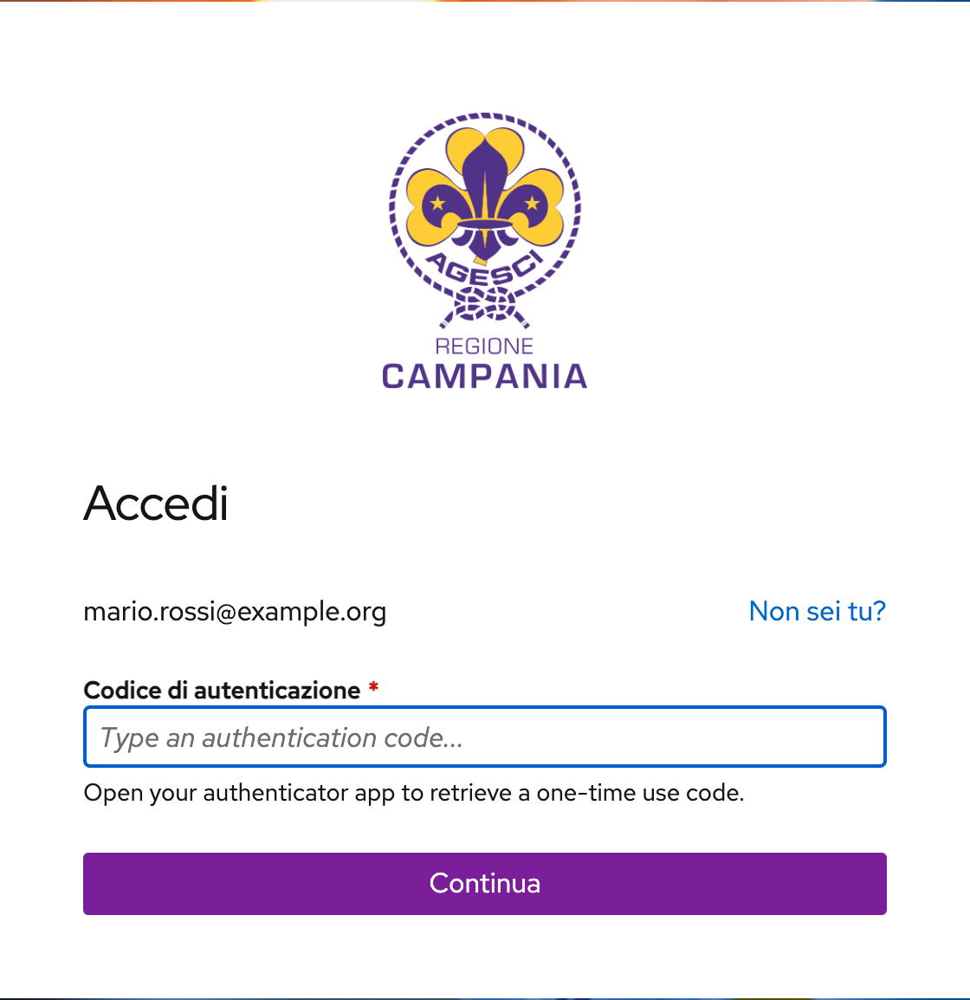

Prova queste strade, nell'ordine.

**a) Hai cambiato telefono? Controlla prima l'app sul telefono nuovo.** Google Authenticator
(con il tuo account Google) e Microsoft Authenticator (con il backup attivo) riportano i codici
sul telefono nuovo da soli. Se trovi la voce *Piattaforme Regionali Scout Campania* o il tuo
indirizzo email, usa quel codice e hai finito.

**b) Hai i codici di recupero?** Sono codici di 12 caratteri, da usare una volta sola, che
potresti aver stampato o salvato. Se li hai, dopo la password compare la scelta del metodo:
scegli **Chiavi di recupero**…

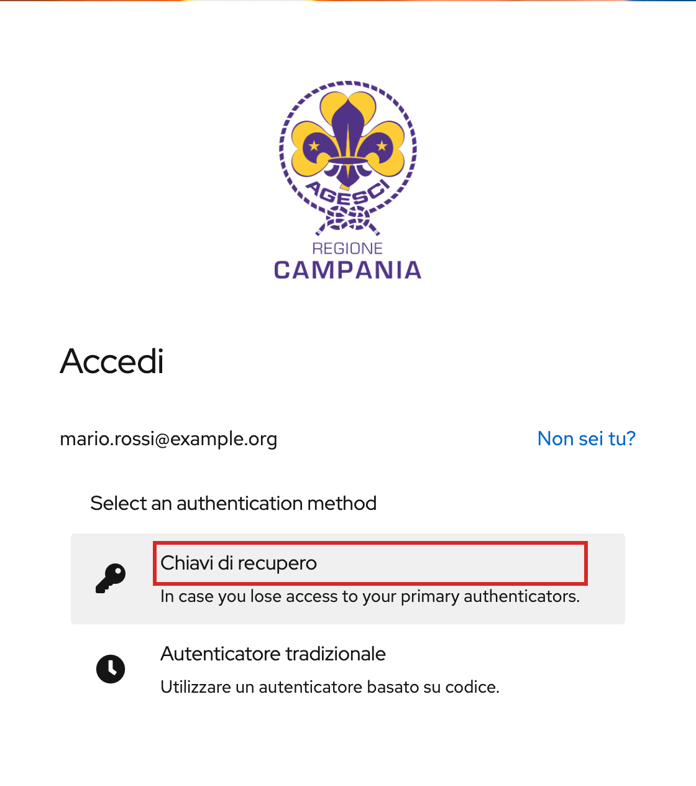

…e inserisci un codice. Ogni codice vale una volta sola: cancellalo dal foglio dopo averlo usato.

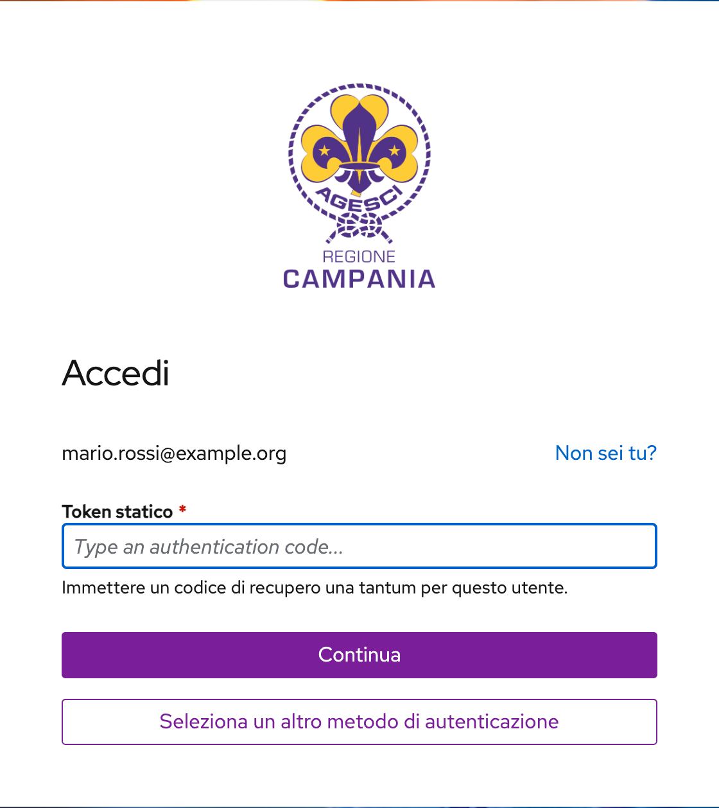

Se la scelta non compare, non hai codici di recupero: passa al punto c.

**c) Hai una passkey** (impronta, Face ID, Windows Hello) **su un altro dispositivo?** Apri la
pagina di accesso da quel dispositivo: il browser propone la passkey e non servono né password
né codice.

**d) Nessuna delle tre?** Usa la procedura della [password dimenticata](#2-ho-dimenticato-la-password),
anche se la password la ricordi: con il link che ricevi per email entri **senza** il codice
dell'app.

Una volta dentro, in tutti i casi, vai al punto 4 e [collega il telefono nuovo](#4-collegare-il-telefono-nuovo).

## 2. Ho dimenticato la password

1. Nella pagina di accesso clicca **Hai dimenticato il nome utente o la password?**

   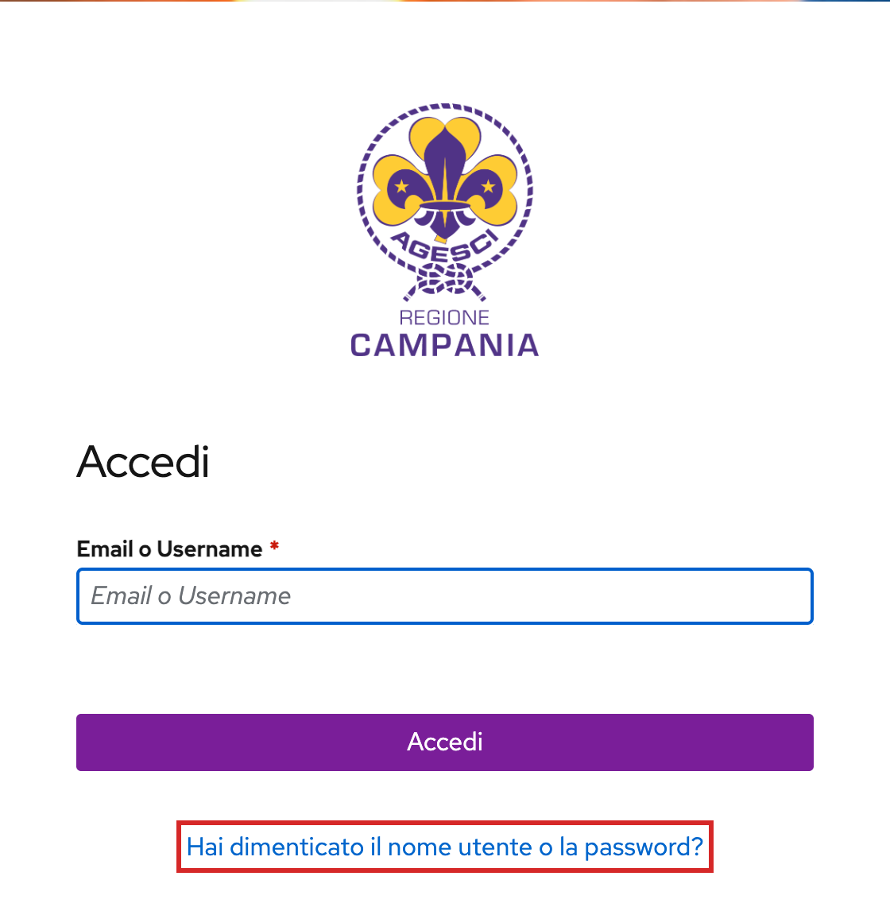

2. Scrivi l'indirizzo email con cui sei registrato e clicca **Continua**. Se l'account te l'ha
   creato un invito (per esempio da Tana), è l'indirizzo a cui è arrivato l'invito.

   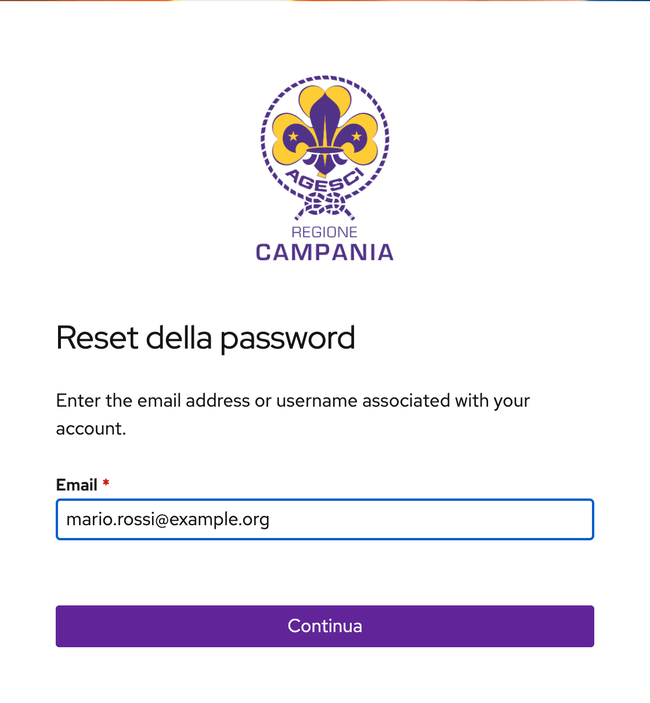

3. La pagina ti dice di controllare la posta. Lasciala aperta.

   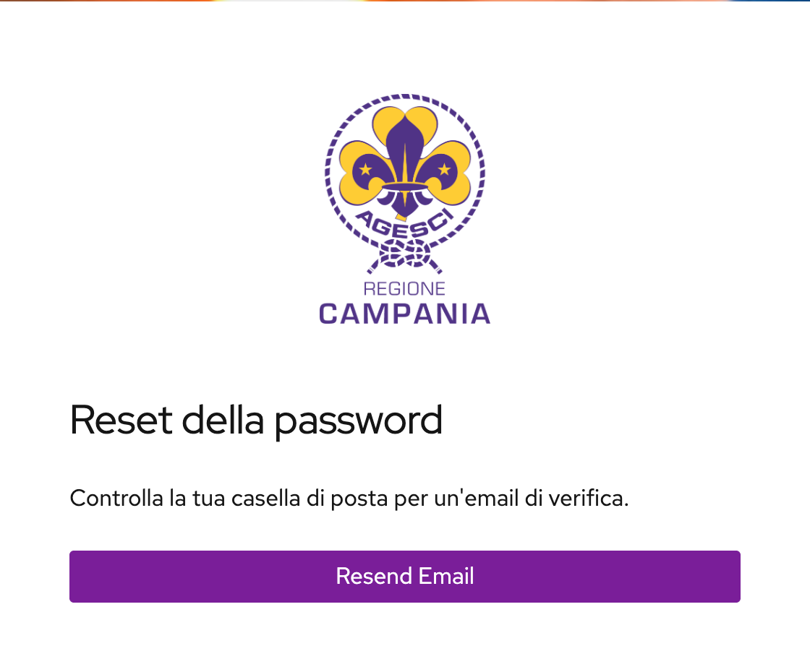

4. Nella posta trovi un'email **«Recupero password — Piattaforme Regionali Scout Campania»**.
   Clicca **Reimposta la password**. Il link vale **30 minuti**: se scade, ricomincia dal punto 1.

   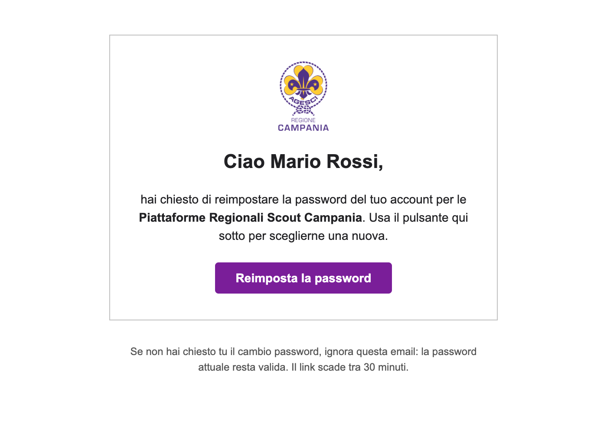

5. Si apre una pagina che conferma il tuo indirizzo: clicca **Continua**.

   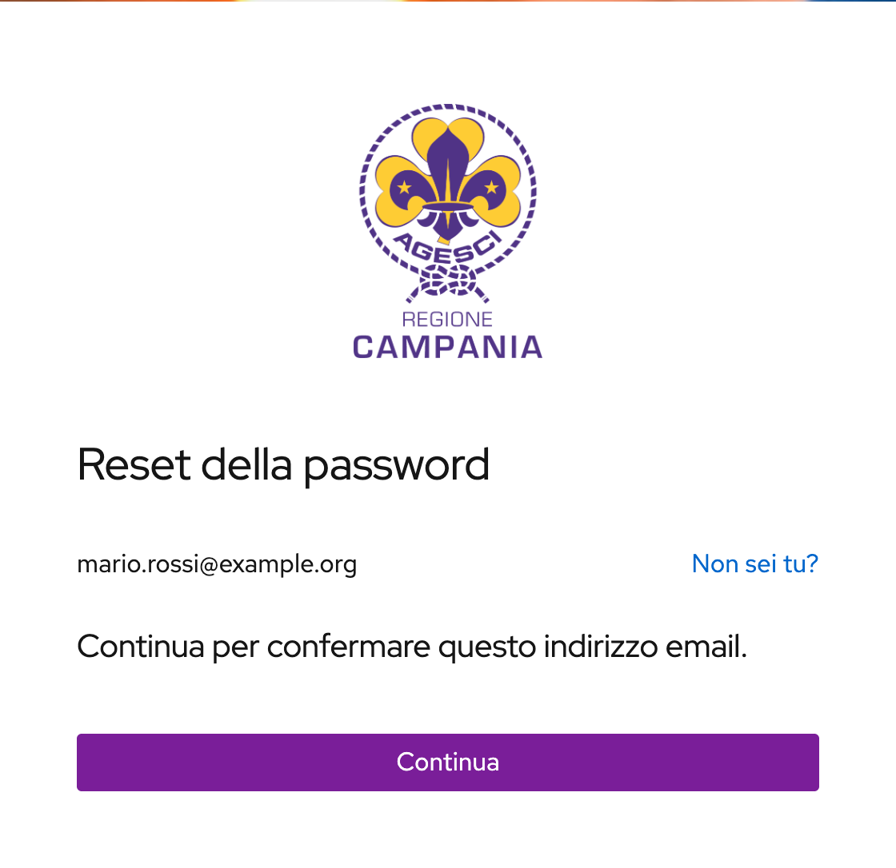

6. Scegli la nuova password, scrivila due volte e clicca **Continua**.

   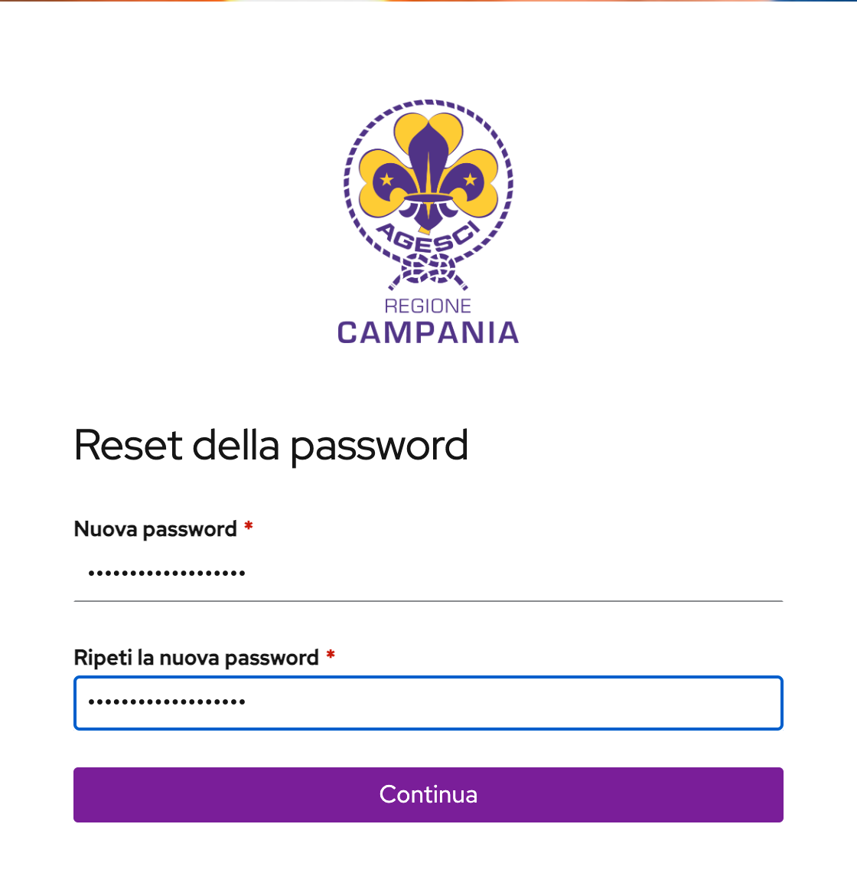

Sei dentro: vedi l'elenco delle piattaforme a cui puoi accedere. Da qui, o dalla piattaforma come
sempre, entri con la nuova password.

Se eri qui perché hai perso il telefono, ora vai al punto 4 e [collega il telefono nuovo](#4-collegare-il-telefono-nuovo).

## 3. L'email non arriva

- Aspetta qualche minuto e guarda anche nello **spam** o nella posta indesiderata.
- Controlla di aver scritto l'indirizzo giusto: deve essere quello con cui sei registrato (per
  chi è stato invitato, quello a cui è arrivato l'invito). Con un indirizzo sbagliato la pagina
  si comporta allo stesso modo, ma l'email non parte.
- Nella pagina «Controlla la tua casella di posta» puoi cliccare **Resend Email** per riceverla
  di nuovo.
- Se dopo questi tentativi non arriva, o non puoi più leggere quella casella di posta, scrivi
  all'amministratore (punto 6).

## 4. Collegare il telefono nuovo

Da fare appena sei dentro, con il telefono nuovo in mano e l'app di autenticazione installata.

1. In alto a destra clicca l'**ingranaggio** (Impostazioni).

   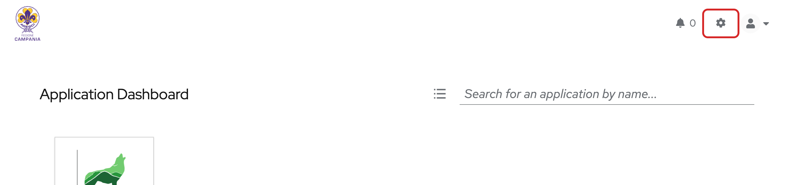

2. Apri **Credenziali**. In *Dispositivi MFA* metti la spunta sul vecchio dispositivo e clicca
   **Elimina**.

   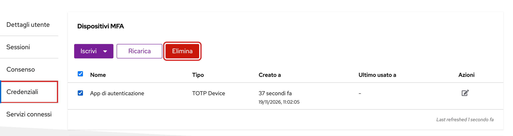

3. Conferma con **Elimina**.

   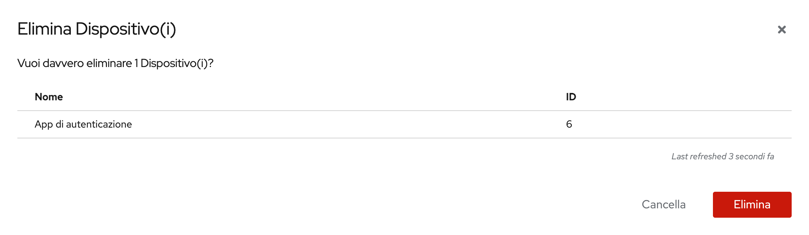

4. Clicca **Iscrivi** e scegli **App di autenticazione sul telefono**.

   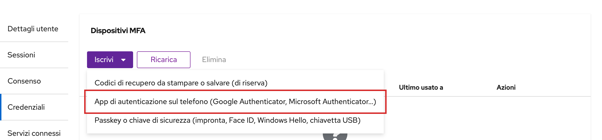

5. Con l'app sul telefono inquadra il codice QR (nell'app: *Aggiungi* o *+*, poi *Scansiona un
   codice QR*). Scrivi sotto il codice di 6 cifre che compare nell'app e clicca **Continua**.

   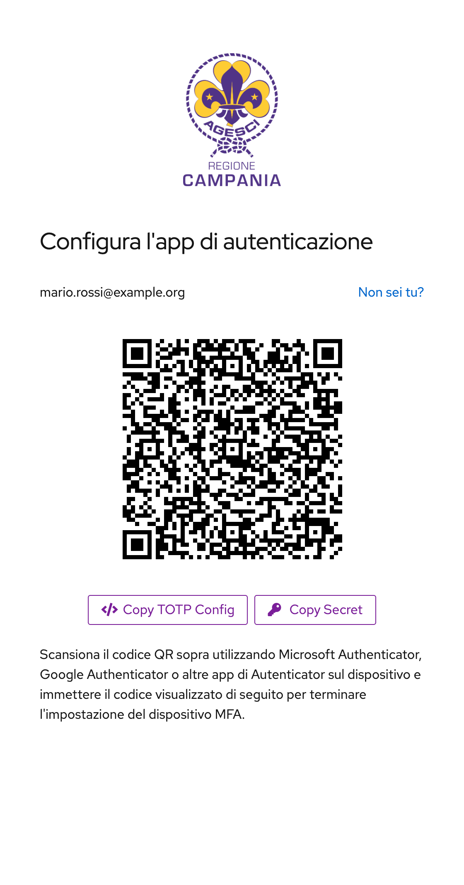

Fatto: dal prossimo accesso il codice arriva dal telefono nuovo.

## 5. Evitare che succeda di nuovo

Sempre in **Impostazioni → Credenziali**, clicca **Iscrivi** e aggiungi:

- **Codici di recupero da stampare o salvare.** Compaiono sei codici: stampali o salvali in un
  posto sicuro, non sul telefono (sono la riserva se perdi proprio il telefono). Poi clicca
  **Continua**.

  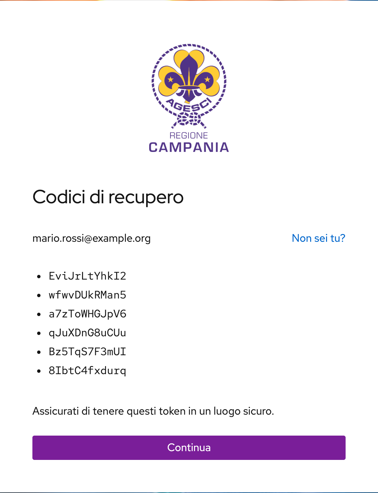

- Se vuoi, una **passkey** sul computer che usi di solito: un secondo metodo indipendente dal
  telefono.

Alla fine in *Dispositivi MFA* devi vedere almeno l'app e i codici di recupero.

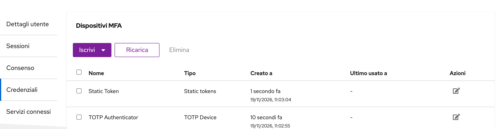

## 6. Quando scrivere all'amministratore

Solo in questi casi, che non puoi risolvere da solo:

- non puoi più leggere l'email con cui sei registrato (indirizzo chiuso o cambiato);
- l'email di recupero non arriva neanche dopo i controlli del punto 3;
- dopo l'accesso una piattaforma ti risponde che non hai il permesso di entrare. Gli account
  creati con un invito valgono solo per la piattaforma che ha invitato (per esempio solo Tana).

Scrivi a chi ti ha dato l'accesso alla piattaforma (per Tana, chi ti ha invitato) o alla
segreteria regionale. Indica nome e cognome, l'email con cui sei registrato, la piattaforma che
usi e cosa hai già provato di questa guida. **Non mandare mai password né codici**: nessuno te li
chiederà.
